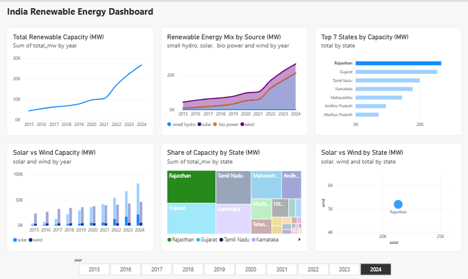

# India Renewable Energy Capacity Analysis (2015-2024)

An end-to-end data project that turns 10 years of government PDF reports into a cleaned dataset, a SQL database and an interactive dashboard.

## What it does
- Extracts state-wise installed renewable capacity (solar, wind, small hydro, bio-power) from 10 annual MNRE PDF reports
- Handles layouts that changed from year to year (11 to 15 columns)
- Cleans inconsistent state names and merges Dadra & Nagar Haveli with Daman & Diu
- Validates the extraction: state values add up to each PDF's printed total
- Stores the result in a SQLite database
- Visualises the data in a Power BI dashboard with a year selector

## Tech stack
Python, pdfplumber, pandas, SQLite, Power BI

## Project structure
- `reports/` - the 10 source PDFs (RE_Capacity_YYYY.pdf)
- `scripts/` - extraction, cleaning and database scripts
- `output/` - cleaned CSV and SQLite database
- `dashboard/` - Power BI file and dashboard screenshot

## How to run
1. `pip install pdfplumber pandas`
2. `python scripts/extract_data.py`
3. `python scripts/fix_names.py`
4. `python scripts/build_database.py`
5. Open `dashboard/renewable_energy_dashboard.pbix` in Power BI Desktop

## Key findings
- India's renewable capacity grew from about 40 GW (2015) to about 144 GW (2024)
- Solar grew from about 4 GW to about 82 GW, becoming the largest source
- Wind roughly doubled, from about 23 GW to about 46 GW
- Rajasthan, Gujarat and Tamil Nadu lead in 2024

## Dashboard

## Data source
Ministry of New and Renewable Energy (MNRE), India: state-wise installed capacity of renewable power, as on 31 March each year.